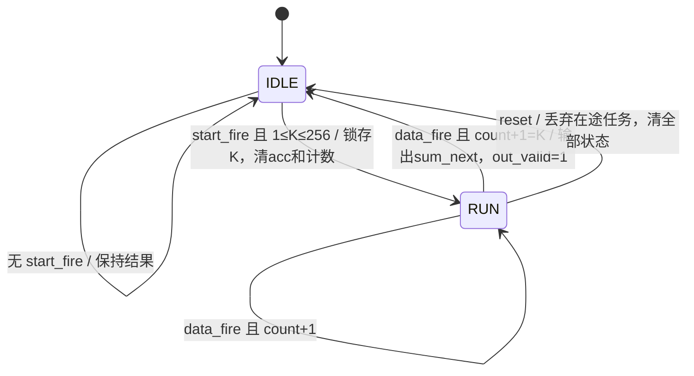

# 第002步：可配置长度整数点积

2026-10-18补充：本版作为串行基线保留。[整体优化路线](../OPTIMIZED_LEARNING_PLAN.md)新增全部K范围的位宽复查和统一测量口径；[审计结果](../optimization/audit_results.json)核对本版原验收哈希，避免后续优化覆盖基线。

本目录按用户提供的《002_可配置长度整数点积_项目式学习.md》实现独立教学核心。它与现有 NYCU GEMV 的接口分开：这里是**同步高有效复位、9 位 K、24 位完整整数结果**，不包含 RAM、偏置、激活和重量化。

## 直接查看

| 文件 | 内容 |
|---|---|
| dot_serial_cfg.v | DUT：一个有符号 8×8 乘法表达式、一个 24 位累加器 |
| dot_int8_reference.m | 独立 MATLAB 数学参考 |
| tb_dot_serial_cfg.v | 每拍自检、输入任务队列、同步复位检查、仿真看门狗 |
| verify_step002.py | 固定种子激励、独立 Python 周期模型、逐边沿核对 |
| vectors.json | 已完成任务的完整输入、数学期望、接受与完成周期 |
| results.json | 最新仿真汇总、工具版本、任务延迟与源文件 SHA256 |
| simulation.log | RTL 仿真实际完成日志 |
| matlab_console.log、matlab_results.json | MATLAB 实际运行记录 |
| trace_example.csv | 文档 K=3 示例的六个边沿，数据来自已与 RTL 核对的 Python 模型 |
| build/rtl_trace.csv | 全部 RTL 实测逐拍记录 |
| first_failure.json | 保留首次 MATLAB 环境启动失败 |
| REPORT.md | 验收结果、前置项边界、失败及处理记录 |

## 两状态控制图

状态由 busy 寄存器表示，未另设重复的状态寄存器。下面的接受事件均须满足 reset=0；复位边沿优先清除全部状态。



IDLE：start_ready=1、in_ready=0。RUN：start_ready=0、in_ready=1。

`start_fire = start && start_ready`；`data_fire = in_valid && in_ready`。同步复位边沿两个事件均取消。同一个边沿不能既启动又接收数据；完成边沿不能接受新启动，下一边沿可以。发送方保持 start 到再次空闲，会在下一可接受边沿形成新的启动。

out_valid 和 cfg_error 每拍默认清零；事件产生一拍脉冲。非完成、非复位边沿 out_data 保持上次结果。运行时判断只读 k_latched，外部 k_cfg 可以改变。无效输入不改变部分和与计数，没有硬件超时。

## 数值推导与手算

K 采用直接数值表示，256 需要 9 位；0 与 257～511 非法。已接受计数同样采用 9 位，每次 data_fire 计算 9 位 count+1。

乘积范围是 [−16256,16384]，16 位有符号足够。K=256 时和的范围是 [−4161536,4194304]；23 位有符号最大值 4194303 不足，因此采用 24 位。乘积显式符号扩展到 24 位，再加到有符号部分和。没有舍入、截位或饱和。

| K | 输入 | 期望 |
|---:|---|---:|
| 1 | x=w=[−128] | 16384 |
| 3 | x=[2,−3,4]，w=[1,2,−1] | 2−6−4=−8 |
| 256 | x=w，全为 −128 | 256×16384=4194304 |

完成时 out_data 写入组合值 sum_next，包含当前乘积；不能读取非阻塞赋值尚未更新的 acc。

## 运行

在仓库根目录执行：

```powershell
python study/step002/verify_step002.py
```

只需要 Python 标准库与实际 RTL 仿真器，优先 Icarus，否则使用本机 Vivado 2025.1。可用 `$env:VIVADO_BIN` 指定其他 Vivado bin 目录。向量由 seed=20261015 生成。

同时运行 MATLAB：

```powershell
python study/step002/verify_step002.py --matlab D:/matlab/bin/matlab.exe
```

如果 MATLAB 因沙箱环境无法启动，可在本目录单独运行：

```powershell
& 'D:/matlab/bin/matlab.exe' -batch "test_step002_reference"
```

再回到仓库根目录合并验证结果：

```powershell
python study/step002/verify_step002.py --use-matlab-results
```

复用 MATLAB 结果时检查任务数量及文件时间；若输入向量或 MATLAB 源码更新，必须重跑 MATLAB。结果记录不是跨机器的密码学证明，提交时一并保存 results.json 中的源码哈希。

综合脚本 synthesize.tcl 目标是 Arty A7 对应的 xc7a100tcsg324-1，时钟约束 10 ns，仅做 OOC 综合。本机已成功生成报告：131 Slice LUT、69 FF、0 DSP、0 BRAM。0 DSP 表示此次乘法映射到 LUT 逻辑。报告口径和时序限制见 REPORT.md。

在仓库根目录重新综合：

```powershell
& ./study/step002/run_synthesis.ps1
python study/step002/verify_step002.py --use-matlab-results
```

PowerShell 脚本在系统临时英文目录复制 DUT 和 Tcl，完成后将报告保存回本目录；临时工作目录保留供排查。综合后才创建的10 ns时钟用于网表时序估计，不代表板端100 MHz收敛。
