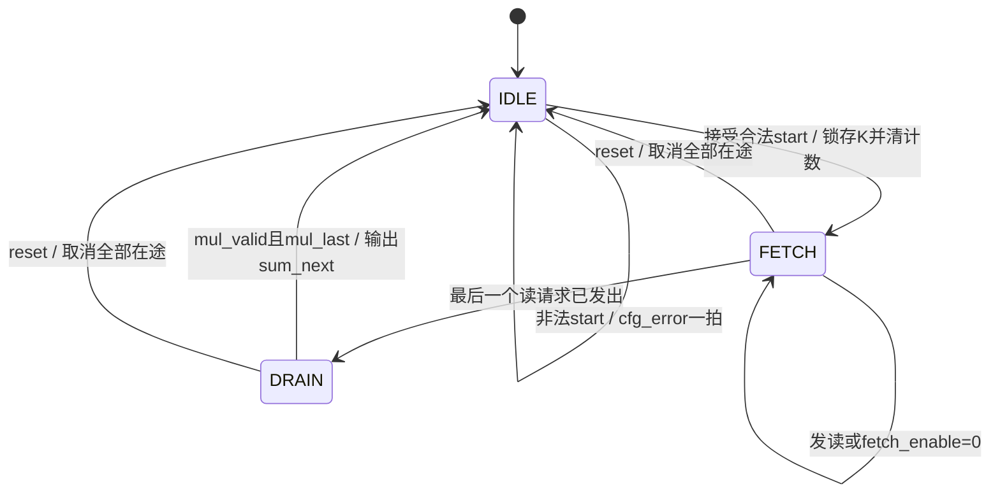

# 第003步 同步存储器读取与流水有效标记

日期：2026-10-16。前置：第二步已通过RTL仿真、MATLAB和综合，并已核对其保存的源码SHA256。当前工作区未提供单独的第三步文档，本规格依据第二步第14节的扩展定义制定。

## 1 目标与数值

计算仍为y=Σx[j]w[j]，1≤K≤256。输入为有符号INT8，16位乘积显式符号扩展到24位后累加，无偏置、激活、舍入、截位或饱和。极值仍是−4161536和4194304。

本步骤将操作数来源改为两块同步RAM。每次任务读取0～K−1；每块RAM有256个8位元素，端口地址8位。长度和请求/退休计数仍为9位，允许直接表示256。最后一次读的地址是255；请求计数达到256后不再发读，不能把计数低8位的回绕当成新请求。

## 2 核心接口

| 信号 | 方向 | 位宽 | 合同 |
|---|---|---:|---|
| clk、reset | 输入 | 各1 | 上升沿工作，同步高有效复位 |
| start、start_ready | 请求输入/就绪输出 | 各1 | 空闲时接受；启动拍锁存K，不发读 |
| k_cfg | 输入 | 9 | 1～256合法；0及257～511产生cfg_error，不执行 |
| fetch_enable | 输入 | 1 | 运行且未发完时，1允许发读；0只暂停新的请求 |
| x_rd_en、w_rd_en | 输出 | 各1 | 成对使能；复位、空闲和排空期间均为0 |
| x_rd_addr、w_rd_addr | 输出 | 各8 | 成对地址，依次0～K−1，仅使能时有效 |
| x_rd_data、w_rd_data | 输入 | 各8有符号 | 请求上升沿后得到固定一拍RAM响应 |
| busy | 输出 | 1 | 启动后为1，直到最后一个乘积已累加并写出结果 |
| out_data | 输出 | 24有符号 | 非完成且非复位时保持旧结果 |
| out_valid、cfg_error | 输出 | 各1 | 完成/非法启动的单拍标记，无输出背压 |

RAM没有ready/rvalid引脚，因为延迟固定；控制器用自身寄存器产生对齐的rsp_valid。该接口不适用于可变延迟RAM或AXI。外部fetch_enable也不是响应背压。

## 3 存储包装接口

dot_mem_top包含两块sync_byte_ram，另提供host_we、host_addr[7:0]、host_x/host_w[7:0]和host_ready。一个host握手把同一地址的一对x/w写入RAM。

`host_ready = !busy && !start && !reset`。只在host_we&&host_ready的上升沿写入。运行时写请求不接受；start与host_we同时出现时启动优先，写入不接受，发送方应根据host_ready重试。非法start也会在该边沿禁止写入。

RAM没有复位。同步reset清控制器、全部valid/last、乘积寄存器、部分和和输出，但保留存储数据。首次任务前必须装入全部0～K−1元素；不能依赖未初始化RAM。复位后可以用原存储数据重新启动。

## 4 请求、乘法与累加

定义三个有效事件，复位优先取消该边沿的全部事件：

1. read_fire：busy&&fetch_enable&&issued_count<K。RAM在此上升沿后更新读数据，同时保存rsp_valid=1及rsp_last=(issued_count+1==K)。
2. 下一上升沿，旧rsp_valid为1时，将RAM数据的乘积保存到product_reg；同拍把旧rsp_valid/rsp_last传到mul_valid/mul_last。
3. 再下一上升沿，旧mul_valid为1时，把旧product_reg符号扩展后加入acc。若mul_last为1，将sum_next输出、置out_valid并清busy。

每一级没有额外ready，不能任意冻结其中一级。read_fire为0时必须注入无效标签；乘积数据本身可以保持旧值，但只有mul_valid为1才允许累加。标签无效时last必须为0。

不切分反馈加法器：累加仍在单拍完成，因此连续供数时有效MAC可每拍一次。本步骤增加的是乘法寄存器，不是多拍累加反馈。

## 5 状态与排空

FETCH和DRAIN是busy与issued_count的组合解释，没有另建状态寄存器。DRAIN期间busy保持1，输入地址不能再被读取，流水继续推进。完成边沿前busy仍为1，不能在该边沿接受新任务；下一边沿可接受。

issued_count只在read_fire增加；retired_count只在有效累加增加。任务完成后两个计数保留K，启动/复位时清零，方便仿真测量；retired_count不参与功能控制，综合可能优化掉它，不是可读硬件CSR。

每个非复位边沿处理后应满足：

`issued_count − retired_count = rsp_valid + mul_valid`。

在途最多两项。这个守恒关系比只看最终点积更容易定位漏项和重复累加。

## 6 时序与测量

无停顿时：启动C0，第一读C1，第一乘积寄存C2，第一累加C3；最后一读CK，最后一乘积CK+1，最后一累加CK+2。延迟为K+2，归约阶段II=1。

只统计任务尚有请求未发出时fetch_enable=0的周期为S，则启动到完成延迟是K+2+S。最后一读后fetch_enable=0不增加延迟，因为在途数据必须排空。测试分别独立计数S和测量输出边沿，再核对公式。

每次计算读取K个x字节和K个w字节，即2K字节输入RAM端口流量；装载阶段另有K个host写握手，共2K字节。结果从24位接口输出，本步骤没有结果RAM或DMA。报告计算延迟须与装载时间分开，不能用K+2冒充端到端延迟。

## 7 实验与验收

- K=1、3、4、255、256，正负极值及明确手算。
- 首次发读前暂停、请求间空拍、长暂停、末读后持续禁止发读。
- 运行中外部K变化、busy时start、保持start到空闲、最早下一次启动。
- host写与start冲突、运行中host写被拒绝、完成后host写可接受。
- 在首次发读前、RAM响应、乘法寄存、部分和、末项累加边沿复位。
- 复位后不重载RAM立即重启，验证存储保留而valid/last彻底清空。
- 全部256种非法9位长度，至少100个固定种子随机任务。
- 实际RAM读数据、请求地址、有效标签、末项标签、计数守恒和最终数学结果自动核对。
- 完成综合，检查RAM推断、乘法映射和关键算术的位宽/符号告警；报告阶段与约束范围。

实际结果见REPORT.md和results.json。下一阶段可比较预取/存储布局或并行PE，本步骤不引入真实网络与陀螺数据。
