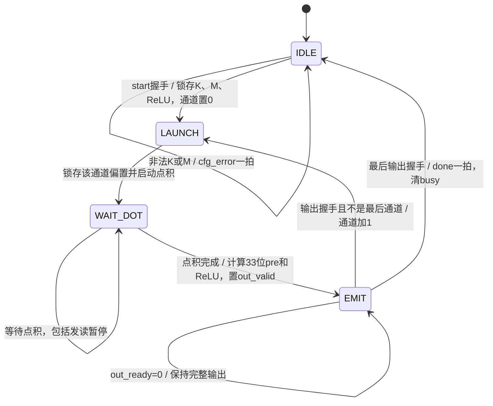

# 第005步 多输出全连接层、偏置与ReLU

日期：2026-10-18。状态：已实现、仿真、MATLAB与综合通过。无单独外部第005步文档，本规格依据第四步报告的后续路线制定。

## 1 从点积到全连接层

输入x长度K，权重W形状M×K，偏置bias长度M：

`dot[i]=Σ W[i,j]x[j]`；`pre[i]=dot[i]+bias[i]`；`y[i]=max(pre[i],0)`或关闭ReLU直接输出pre。

本步选择1≤K≤256、1≤M≤8。四路K并行核心依次处理各输出行，不增加8组独立乘法器。目标是能核对矩阵形状、通道调度、偏置尺度和输出协议。

## 2 数值合同

| 值 | 类型 | 说明 |
|---|---|---|
| x、W | INT8 | −128～127 |
| 单个乘积 | 有符号16位 | −16256～16384 |
| dot | 有符号24位 | 所有合法K完整精度 |
| bias | INT32 | 不额外限制其数值范围 |
| pre、y | 有符号33位 | 保留任意INT32偏置与完整点积之和 |

K=256时dot范围[−4161536,4194304]。加任意INT32偏置后范围[−2151645184,2151677951]，超出INT32。dot和bias必须分别符号扩展到33位，再相加；不能先在32位中溢出后再扩展。

ReLU检查pre的33位符号，在加偏置之后执行。输出保留完整整数，不重量化。真实量化网络的bias须与x、W乘积累加处于同一数值尺度；本步没有训练和量化精度评估。

## 3 存储与地址

- x：256字节，分成4个64×8 bank。
- W：最多8×256字节，分成4个512×8 bank。
- bias：8×32位，独立的小型存储。

逻辑存储合计2336字节。host用32位数据写一个对象，x/W只取低8位。权重host地址固定为i×256+j，即使K小于256也不压缩行跨度。

点积核的第g组读取x bank地址g，W bank地址i×64+g。最后一组继续复用第四步mask，真实j≥K的bank不读取、不计算。host接口对象/地址表见README.md。

## 4 控制与快照

reset为同步高有效，优先清控制/流水/输出，保留RAM和bias。任何状态复位都取消本层剩余计算。已经握手的输出不能撤销，接收方应丢弃被复位打断的不完整层。

busy期间start不接受、host写不接受。配置只在任务启动握手时锁存；外部K/M/ReLU变化不能改变当前任务。start与host写同时出现时，不接收写。

## 5 输出握手

out_valid&&out_ready的边沿接受一个输出。输出字段包括通道index、last、dot、pre和y。背压时所有字段及out_valid必须保持；不能一拍脉冲后丢弃结果。

busy保持到最后一个输出被接受，done在该边沿后有效一拍。最后完成边沿前仍忙，下一边沿才能接受新任务。硬件没有超时，TB看门狗只用于结束异常仿真。

## 6 手算

x=[2,−3,4]：

| 输出行 | W | bias | dot | pre | ReLU输出 |
|---:|---|---:|---:|---:|---:|
| 0 | [1,2,−1] | 3 | −8 | −5 | 0 |
| 1 | [−1,0,2] | −2 | 6 | 4 | 4 |
| 2 | [0,0,0] | −1 | 0 | −1 | 0 |

关闭ReLU则输出[−5,4,−1]。若错误地先ReLU后加偏置，这个案例会直接失败。

## 7 测量公式

令G=ceil(K/4)。每个通道需要点积G+3周期，外加启动核心、接收核心结果和输出握手三个控制周期。无暂停且接收端一直就绪时：

`layer_latency=M×(G+6)`。

若计算阶段有S个发读暂停、输出阶段有B个有效输出被背压的边沿，则实测延迟为`M×(G+6)+S+B`。S、B分别计数，再与实测完成边沿核对，不能从总延迟反推后声称独立验证。

本层执行MK次MAC，输入/权重RAM共读2MK字节。每个输出都重新从输入RAM读取x，未跨输出通道广播复用。偏置每行读取一次，ReLU和偏置加法另计，不混入MAC数。

host若独立装载整层，写次数为K+MK+M；有效参数字节K+MK+4M，32位host接口每次只写一个对象。装载时间不包含在上式计算延迟内。

## 8 验收

- [x] 第四步状态与源码哈希核对一致，核心文件未改动。
- [x] K=1/255/256、M=1/8和K=256/M=8最大组合通过。
- [x] 全范围INT32偏置、ReLU开关、零阈值与33位正负极值通过。
- [x] 权重固定行跨度、bank映射、尾部mask和输出顺序通过。
- [x] 输出长背压、发读暂停、运行时配置扰动、非法配置通过。
- [x] 多阶段复位、已输出部分通道后复位及不重载RAM重启通过。
- [x] MATLAB逐个核对dot/pre/y，RTL与Python逐拍对齐。
- [x] 实际综合、资源、时序范围和复现命令已保存。

实际证据见REPORT.md、outputs.csv、metrics.csv及results.json。下一步应定义33位结果到INT8的重定标、舍入和饱和，再连接双层小网络。
