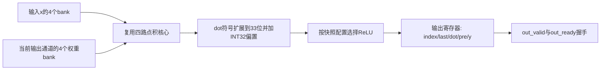

# 第005步：多输出全连接层、偏置与ReLU

2026-10-18补充：[分布式RAM变体](../optimization/step005/)已通过同39,311边沿核对，较大W容量下LUT增加较多，因此当前网络推荐保留BRAM。第006步已加入逐层量化和实际训练的小网络；[三段流水改进](../optimization/step006_pipelined/README.md)与[完整路线](../OPTIMIZED_LEARNING_PLAN.md)给出后续入口。

第四步已验收。本步复用其原版本四路点积核心，顺序执行最多8个输出通道，形成可解释的整数全连接层：

`dot[i]=Σ W[i,j]x[j]`，`pre[i]=dot[i]+bias[i]`，`y[i]=ReLU(pre[i])`或直接输出pre。

K=1～256，M=1～8；输入/权重INT8、偏置INT32；dot为完整24位，pre/y为完整33位有符号数。每个有效输出同时携带通道号、last、dot、pre、y，便于逐个中间结果核对。

## 文件入口

| 文件 | 内容 |
|---|---|
| fc_int8_top.v | 多通道控制、输入/权重RAM、偏置存储、33位加法、ReLU、输出握手 |
| ../step004/dot_banked_core.v、bank_ram.v | 直接复用的四路MAC与同步bank，未改动其源文件 |
| fc_int8_reference.m | 独立MATLAB INT64数学参考 |
| test_step005_reference.m | 核对每个通道的dot、pre和ReLU输出 |
| tb_fc_int8.v | 实际RAM、独立完整层黄金、通道顺序、背压保持及复位自检 |
| verify_step005.py | Python层控制/周期模型，复用已验证的核心模型并逐拍核对 |
| vectors.json | 全部128组主工作负载，含96组随机层和K=256/M=8最大组合 |
| outputs.csv | 每个通道的中间值、首次有效与接受边沿 |
| metrics.csv | 每层周期、发读/输出停顿、MAC、读字节和装载次数 |
| trace_*.csv | 手算及输出背压示例的逐拍记录 |
| simulation.log、matlab_console.log | 实际运行日志 |
| synthesis_*.rpt、results.json | 同器件综合、验收状态和源码哈希 |
| REPORT.md | 实际验收、测量、取舍和本阶段边界 |

## 数据路径



各输出通道顺序使用同一个四路计算核心。x在输入RAM中保留，W按输出行存储。这里没有8个通道同时计算，也没有输出重量化。

## host装载

host接口每个握手写一个对象，host_data为32位；写x/W时仅取低8位并按INT8解释，写bias时取完整32位。

| host_kind | 对象 | host_addr |
|---:|---|---|
| 0 | x[j] | j，范围0～255 |
| 1 | W[i,j] | i×256+j，范围0～2047；行跨度固定256，不是K |
| 2 | bias[i] | i，范围0～7 |
| 3 | 不支持 | host_ready=0 |

输入/权重bank仍为`j%4`，bank内地址为`floor(j/4)`；权重再加`i*64`。host_ready只在非复位、空闲、start=0且地址/对象合法时为1。运行时写、启动同拍写和非法地址均不接受。RAM和bias存储没有复位，首次启动前须装入本层所有真实输入、权重和偏置。

## 输出握手

启动拍锁存K、M和relu_cfg；任务运行期间外部配置变化不影响本任务。非法K/M产生一拍cfg_error，不启动。

out_valid=1且out_ready=1的边沿接受一个输出。out_valid=1而out_ready=0时，index/last/dot/pre/y全部保持。最后一个输出未接受前busy始终为1；最后一次握手边沿之后done脉冲一拍并清busy。完成边沿前仍忙，下一边沿才可接受新start。

同步高有效reset清控制、流水及输出寄存器，取消剩余输出，保留RAM和bias。已经接受的输出无法撤回；接收端应按复位取消当前不完整层，重新启动后从通道0接收。没有硬件超时。

## 运行

在NYCU-Lab3仓库根目录：

```powershell
python study/step005/verify_step005.py
```

Python仅需标准库，使用Icarus或本机Vivado Simulator。MATLAB参考在step005目录执行：

```powershell
& 'D:/matlab/bin/matlab.exe' -batch "test_step005_reference"
```

回到仓库根目录合并新鲜的MATLAB结果，并重新核对RTL：

```powershell
python study/step005/verify_step005.py --use-matlab-results
```

实际综合：

```powershell
& ./study/step005/run_synthesis.ps1
```

本机按此前确认的环境限制，经权限流程在沙箱外运行Vivado和MATLAB。综合脚本在临时英文路径复制本步顶层及第四步两个依赖文件，生成报告后保存回本目录。复现无需NumPy。

## 数值范围

点积范围仍为[−4161536,4194304]。任意INT32偏置相加后可到[−2151645184,2151677951]，已经超出INT32。33位输出足够，不能静默沿用24位或32位截断。

ReLU在加偏置后执行：保留pre作为中间值，再根据其33位符号决定输出0或原值。当前没有scale、非零zero-point、舍入与饱和。若对应真实量化模型，bias必须与乘积累加处于同一数值尺度；当前位级压力测试不代表网络量化精度。

下一层若仍要求INT8输入，需要先明确定标、舍入和饱和，不能将本步33位输出直接取低8位连接。
