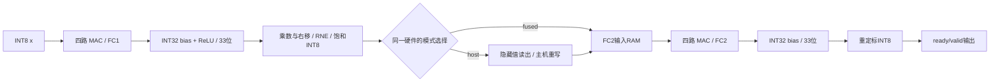

# 第006步：可解释的 INT8 两层网络与隐藏层片内转发

本步完成 `FC → bias → ReLU → requant → FC → bias → requant`。训练、整数模型、主机命令生成、RTL 中间值和性能计数形成闭环。资料依据和前后步骤调整见 [整体优化路线](../OPTIMIZED_LEARNING_PLAN.md) 与 [资料定位](../SOURCE_MAP.md)。

**当前推荐使用[三段重定标流水版本](../optimization/step006_pipelined/README.md)**：功能与本基线一致，10ns综合WNS估计由−7.938ns改善至+1.759ns。下面的100/128拍等指标特指保留的一段重定标功能基线；三段版本为104/132拍，未宣称布局布线通过。

## 本次结果

| 验收项目 | 实测 |
|---|---:|
| 重定标逐拍测试 | 25,516 个周期 |
| 合法输入 / 半整数舍入 / 饱和 | 15,367 / 572 / 10,269 |
| 标量复位 / 非法量化配置 | 26 / 3 |
| 完整两层网络任务 | 624 |
| 逐层 pre 与量化输出 | 每层均检查；6,016 个输出位置 |
| 网络非法配置 / 中途复位后重启 | 8 / 125 |
| 网络仿真边沿 | 181,296 |
| MATLAB 独立重定标核对 | 15,367 |
| 独立测试集进入 RTL | 512 个样本 |
| 浮点 / INT8 / RTL 测试准确率 | 95.3125% / 95.3125% / 95.3125% |

准确率来自 **合成的 16 维非线性二分类问题**，并非陀螺或公开模型基准。INT8 与浮点的预测一致率为 99.609375%；准确率相等不表示每个预测相同。测试集隐藏层与输出层均无饱和。模型为实际训练的 16–8–2 ReLU MLP：训练 1,024、验证 256、测试 512；固定 500 次更新，用验证准确率选择第480次参数。尺度只使用训练集校准。输入、权重、bias、尺度、数据划分哈希均保存。

## 先手算，再看波形

设一层的 `dot=sum(x*w)`，`pre=dot+bias`。第一层令 `active=max(0,pre)`，第二层 `active=pre`。本项目的重定标合同为：

```text
q = clamp[-128,127](round_to_nearest_ties_to_even(active * multiplier / 2^shift))
```

例如 `3/2→2`，`5/2→2`，`−3/2→−2`，`−5/2→−2`；`255/2→128→127`，此时 tie=1 且 saturated=1。先完整求和、加 bias、做激活，再统一舍入和饱和；不能每次 MAC 后截成 INT8。该合同是本项目的明确选择，不保证与任意 TFLite/TVM 舍入实现逐位相同。

## 数据通路



两个 FC 引擎沿用第005步源码，均为4路 MAC，共8路；两层按顺序运行。当前并未共享为单一4路引擎。片内转发避免隐藏值经过主机往返，仍需在 FC2 的 x RAM 中落地；这不等于消除所有隐藏层存储。

### 公平比较

固定同一套硬件、权重、输入和量化配置，只切换 `fused_cfg`。无停顿的 16–8–2 任务：

| 模式 | 计算至最终握手周期，不含初始装载 | 初始主机装载写拍 |
|---|---:|---:|
| 主机转存，额外服务延迟 D=16 | 128 | 170 |
| 隐藏层片内转发 | 100 | 170 |

计算阶段为 1.28 倍；计入两种模式相同的170写拍和1启动拍，则为 `299/271=1.1033` 倍。D 是测试台指定的主机服务延迟，不是实测 DRAM 延迟。主机回写另外需要8拍，状态协议还有4拍差异，总差28拍。完整48组无停顿成对结果见 [comparison.csv](comparison.csv)。

每次 H=8 转发省去逻辑隐藏张量的8字节读出和8字节写回；实际接口是8位隐藏输出、32位主机写载荷，因此省去40字节有效载荷。没有计入地址、控制、总线填充或协议开销，也没有把调试观察值算成强制主机流量。

权重读取、x读取、MAC 对数分别由 RTL 计数，并核对 `K*H` 与 `H*O`。这些是片内 RAM 的有效元素读取，不能直接称为 DRAM 带宽，也不能换算为实测功耗。

## 修改与复现

| 文件 | 修改入口 |
|---|---|
| [reference.py](reference.py) | 精确整数合同、图的形状/类型检查、实际主机加载命令 |
| [requant_i8.v](requant_i8.v) | 33位值 × 无符号16位乘数、RNE和饱和，一个弹性输出寄存器 |
| [mlp2_top.v](mlp2_top.v) | 双层调度、量化元数据、隐藏层转发与回写握手 |
| [train_tiny.py](train_tiny.py) | 固定划分与训练；可改数据公式，必须重新评估和导出 |
| [trained_model.json](trained_model.json) | 受限类型图IR、16–8–2权重和量化参数 |
| [lowered_example.json](lowered_example.json) | IR生成的真实主机命令，测试台按这些记录驱动 |
| [verify_step006.py](verify_step006.py) | 精确黄金、随机/边界向量、真实仿真和指标导出 |
| [test_step006_reference.m](test_step006_reference.m) | 独立的有符号 floor 舍入推导 |
| [results.json](results.json) | RTL、MATLAB、训练结果及源码哈希 |
| [INTERFACES.md](INTERFACES.md) | 可执行接口合同 |

在仓库根目录 PowerShell 中执行（NumPy仅训练需要，黄金和RTL回归仅标准库）：

```powershell
$py = 'C:/Users/11725/.cache/codex-runtimes/codex-primary-runtime/dependencies/python/python.exe'
& $py study/step006/train_tiny.py
& $py -c "import sys;sys.path.insert(0,'study/step006');import verify_step006;verify_step006.BUILD.mkdir(exist_ok=True);verify_step006.generate_quant()"
& 'D:/matlab/bin/matlab.exe' -batch "cd('C:/Users/11725/Desktop/学习资料/AI/NYCU-Lab3/study/step006');test_step006_reference"
& $py study/step006/verify_step006.py
& $py study/optimization/verify_memory_variants.py
& ./study/optimization/run_synthesis.ps1
& $py study/optimization/step006_pipelined/verify_pipeline.py
& ./study/optimization/step006_pipelined/run_synthesis.ps1
& $py study/optimization/audit_learning.py
```

MATLAB结果绑定输入CSV的SHA256，避免仅凭测试数相同接受旧结果。若不调用MATLAB，可先移走既有 `matlab_results.json` 再运行RTL；脚本只对实际存在且匹配的MATLAB结果报告通过。资源与时序见 [优化测量报告](../optimization/REPORT.md)。本版为功能验证版本；综合网表时序与布局布线验收分开记录。
