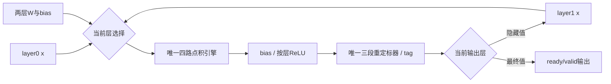

# 第007步：共享四路引擎与混合存储

## 本步要回答的问题

第006步有两个四路MAC引擎、两个通用重定标器，但调度要求第一层全部完成后第二层才开始。这里检查：将原本互不同时计算的硬件合并，是否能维持相同周期，同时降低资源？小x和较大W是否应使用不同存储技术？

数学定义、模型、输入、输出协议保持一致。复制已有模型的测试集不等于重新训练；本步没有改变尺度或选择新模型。

## 从一次手算解释共享

例如x=[2,−3,4]，第一层某行W=[1,2,−1]、bias=3，dot=−8，pre=−5，ReLU后为0。该行经过同一个量化器得到隐藏值，然后写入layer1的x区域。第一层其他行继续使用原x区域，已经完成的隐藏值不会覆盖原输入。

所有隐藏值接受后，同一个点积引擎切换到layer1的x、W和bias，执行第二层。该过程复用算术硬件，保留两层独立参数。它不是让两个网络层同时使用同一组MAC。



## 应当能解释的四个不变量

1. 点积已发组数−已退休组数＝响应级有效组＋乘积级有效组。
2. 量化接受数−量化输出数＝三个寄存器级中当前有效事务数；同步复位取消在途事务。
3. 层0计算时，只允许内部写层1的x；不能覆盖正在读取的层0地址。
4. 最后一个量化值及其index/last接受后才能换层，不能在FC最后一个pre产生时提前换层。

这些条件在实际RTL仿真中检查，不能仅靠最后分类标签正确判断实现无误。

## 怎样测量

使用第006步冻结的624个网络任务和512个测试样本，补充8个H=O=8的边界任务（K=1/17/255/256，各host/fused）。三种RAM模式各跑完整回归。

每种配置另外在以下位置复位并不重载RAM重启：RAM响应、隐藏输出被阻塞、主机仅回写一个隐藏值、第二层乘积、最终输出被阻塞。核对复位后没有幽灵输出，模型参数和原始输入仍可用。

指标包括：初始主机写拍、层1/层2运行拍、桥接等待、发读暂停、隐藏/最终输出阻塞、量化入口阻塞、RAM组数与有效MAC对数。状态拍数可相加；不同原因的阻塞可能重叠，不能把阻塞计数再次直接加到总拍数。

无停顿、片内转发时，本调度的延迟为：

```text
cycles = H*(ceil(K/4)+6) + O*(ceil(H/4)+6) + 8
```

对16–8–2：8*(4+6)+2*(2+6)+8=104拍。主机装载170拍，加启动拍后为275个占用边沿。MAC数16*8+8*2=144；每拍4个槽，整个推理的物理MAC槽利用率为144/(4*104)=34.615%。这个数字包含控制和流水排空；不能把4路乘法器直接写成每拍4个推理。

## 分辨两个优化因素

- 原双引擎与共享全BRAM版的差异，包含算术合并、控制合并和两层RAM地址区域合并。面积变化不能全部归因于MAC数减半。
- 共享全BRAM/混合/全分布式三者只切换RAM_MODE，是存储实现的直接对照。
- 原版本和新版本的逻辑容量、加载命令一致；不能通过减少可用权重容量制造资源优势。

## 修改练习

1. 将RAM_MODE从1切到0或2，检查所有数值与周期仍一致，再看LUT/FF/RAMB变化。
2. 注入fetch_enable暂停，确认只影响新请求，不丢弃在途项；观察issued/retired守恒。
3. 在最终输出阻塞时修改外部K、量化配置和fused，确认已启动任务使用快照。
4. 修改层切换时机为“最后pre接受”，观察测试台能否检测量化tag串层；练习后恢复正确版本。

本步没有新增双缓冲。当前没有真实DMA或主机带宽测量，供数暂停主要来自验证注入；先用明确计数定位问题，下一步按路线研究输出方向复用，再考虑需要批量输入协议的装载重叠。
